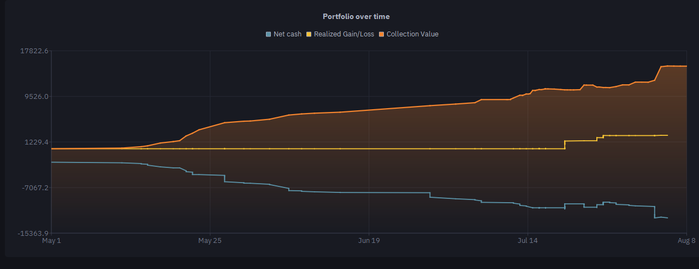
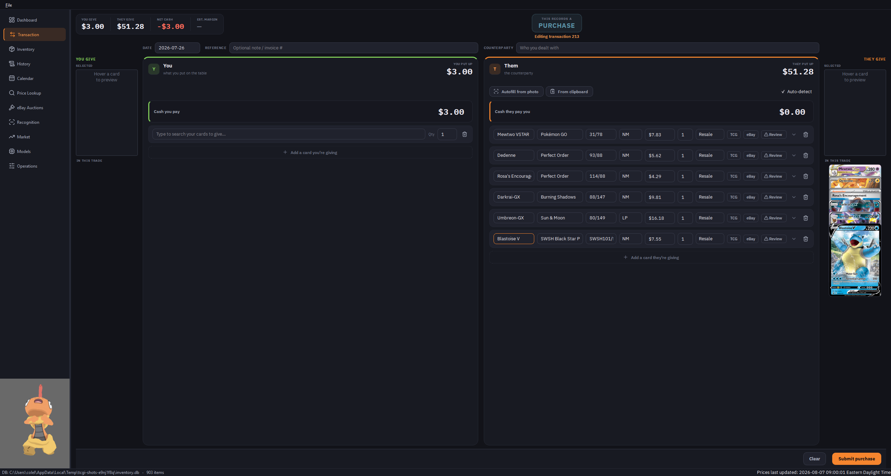
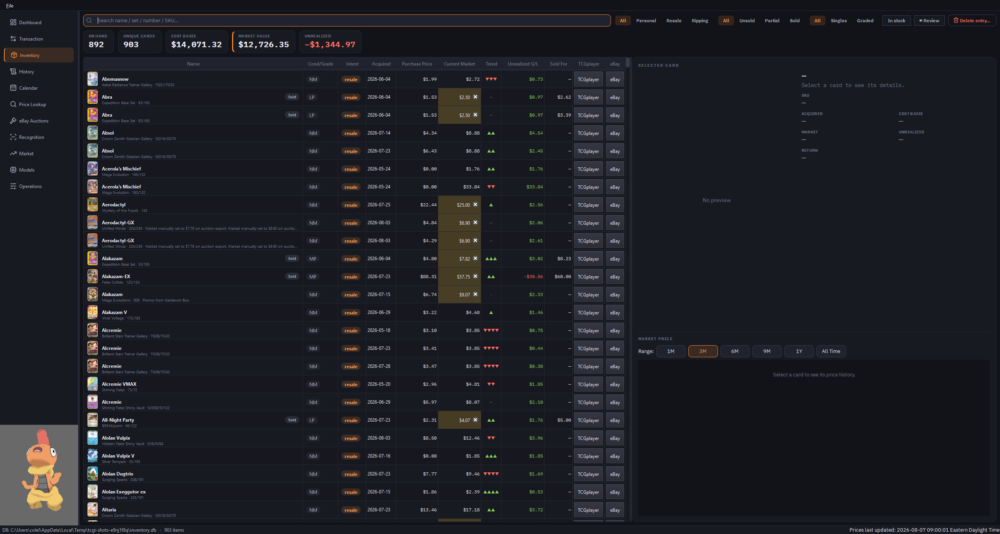
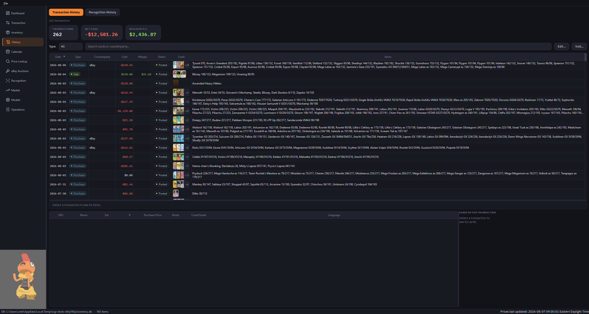

# TCGinventory

A local, single-user **PySide6 desktop app** for running a personal *and*
business trading-card inventory (Pokémon-focused). It records purchases, sales
and trades on a single-card or lot basis, infers what each card cost you, and
tells you what you're actually up or down.

Everything is offline: one SQLite database on your machine, no server, no
accounts, no telemetry.

**v0.7.0** · V1 feature-complete (M0–M6), with post-V1 work ongoing. See
[`CHANGELOG.md`](CHANGELOG.md) and [`specs/05-roadmap.md`](specs/05-roadmap.md).



## What it does

The app is one window with a left nav and eleven destinations:

| | |
|---|---|
| **Dashboard** | Portfolio overview — collection value, cost basis, realized/unrealized P/L, net cash, and highlight strips for top gainers, losers, sellers and upcoming shows. |
| **Transaction** | The single write screen. Everything you post goes through here. |
| **Inventory** | Every lot you hold, with cost, market value, unrealized P/L, intent and a price trend. |
| **History** | The full transaction log with per-card drill-down, plus void and edit. |
| **Calendar** | Scraped card shows merged with your own entries, with conflicts flagged. |
| **Price Lookup** | Chart any card in the catalog and overlay several to compare. |
| **eBay Auctions** | Max-bid planner — what a lot is worth, and what to bid at 70/80/90/100% of that net of shipping and tax. |
| **Recognition** | Photograph cards, draw boxes, label them; the labelled regions train the detector. |
| **Market** | Per-card liquidity, markup and price volatility for everything held for resale. |
| **Models** | What each recognition model serves, what it scored, and its run history. |
| **Operations** | Maintenance hub — imports, exports, backups, price and catalog updates, integrity checks. |

### Posting a transaction

One screen handles purchases, sales and trades. You put what you're giving on
the left and what they're giving on the right; the app infers which kind of
transaction that is from which side carries cards, and shows a live running
total and estimated margin as you go. Submit is blocked if you'd oversell.



### Seeing what you hold



One row per lot. Intent and review flags are editable inline; the panel on the
right shows the selected card's art and its price history.

### Every change, kept



Transactions are never hard-deleted. Voiding one soft-voids it and appends to an
audit log; editing one is an atomic void plus re-post, so the ledger always
reconstructs.

## How the money works

These rules are the heart of the app, and they are not configurable:

- **Money is integer cents.** Never a float, anywhere.
- **Cost basis is inferred, not typed in.** For a transaction, the net
  consideration you gave up is
  `cash_out + Σ(market value of cards out) − cash_in`, and that total is split
  across the cards you received in proportion to their market value. The
  rounding residual goes to the largest-value line, so the split always sums
  back to the total.
- **Disposals draw down FIFO.** Oldest lot first.
- **Intent is per-lot**: `personal`, `resale` or `ripping`. A lot marked for
  ripping is valued at **$0** — it shows as a loss equal to its cost basis, and
  it can never be sold. That is deliberate: you consumed it, you didn't dispose
  of it.

Worked examples are in
[`docs/cost-basis-examples.md`](docs/cost-basis-examples.md); the binding rules
are in [`specs/02-data-model.md`](specs/02-data-model.md).

## Under the hood

Layered, with a hard rule at each boundary:

```
domain/    enums + frozen dataclasses      — no SQL, no Qt
data/      sqlite, migrations, repositories — no Qt
services/  all business logic + money math  — no Qt, headless-testable
ui/        PySide6 only                     — no SQL, no money math
```

`tests/test_headless.py` enforces that the domain and service layers import
without Qt. Migrations are forward-only and append-only — a new numbered file in
`data/migrations/`, never an edit to a shipped one.

Four SQLite files live side by side, but only the first is the ledger:

| file | what it holds |
|---|---|
| `inventory.db` | items, lots, transactions, audit log, catalog, shows — the ledger |
| `pricehistory.db` | catalog-wide daily price history |
| `vision.db` | recognition corpus: captures, images, labelled regions, model runs |
| `auctions.db` | the eBay watchlist (ephemeral by design) |

**Stack:** Python 3.10+ · PySide6 (Qt 6) + QtCharts · SQLite (WAL, foreign keys
on) · httpx, numpy, Pillow, onnxruntime · PyInstaller.

## Install & run

```powershell
# Windows
& "$env:LOCALAPPDATA\Programs\Python\Python312\python.exe" -m venv .venv
.\.venv\Scripts\python.exe -m pip install -U pip
.\.venv\Scripts\python.exe -m pip install -e ".[dev]"
.\.venv\Scripts\python.exe -m tcginventory
```

```bash
# macOS / Linux
python -m venv .venv
.venv/bin/python -m pip install -e ".[dev]"
.venv/bin/python -m tcginventory
```

The database is created and migrated on first launch, and a timestamped backup
is written at every startup.

**Tests and lint:**

```bash
python -m pytest          # set QT_QPA_PLATFORM=offscreen for the GUI tests
ruff check . && ruff format .
```

**Environment overrides:** `TCGINVENTORY_DATA_DIR` (whole data directory),
`TCGINVENTORY_DB` (database file), `TCGINVENTORY_SEED=1` (load demo data into a
fresh database).

**Build the executable:** `pyinstaller --clean --noconfirm
packaging/tcginventory.spec` → `dist/TCGinventory/`. See
[`packaging/README.md`](packaging/README.md).

## Where to read more

- [`specs/`](specs/) — what's being built and why. Start at
  [`specs/README.md`](specs/README.md);
  [`02-data-model.md`](specs/02-data-model.md) is the one to read before
  touching money or schema logic.
- [`docs/decisions.md`](docs/decisions.md) — chronological decision log, newest
  first. The fastest way to understand why things are the way they are.
- [`docs/user-guide.md`](docs/user-guide.md) — how to actually use the app.
- [`docs/glossary.md`](docs/glossary.md) — item, lot, basis, boot, FIFO, intent.
- [`CLAUDE.md`](CLAUDE.md) — per-milestone status and the development setup.
